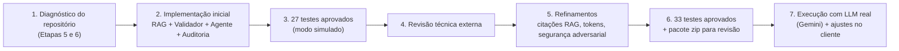
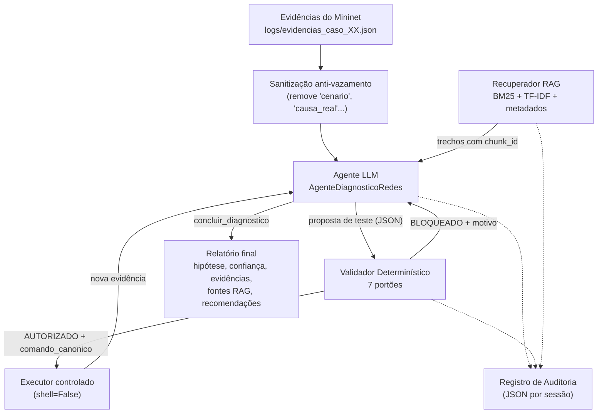

# Relatório Técnico — Etapa 7: Método Proposto

**Projeto:** Agentes Baseados em Modelos de Linguagem para Diagnóstico de Redes com Validação Determinística de Segurança
**Data de referência:** 25 de outubro de 2026
**Branch:** `feat/etapa7-metodo-proposto`
**Situação:** arquitetura completa implementada (RAG + agente LLM + validador determinístico + auditoria), revisada, refinada e executada com um LLM real (Google Gemini). Medição quantitativa com LLM real sobre os logs do Mininet pendente para a Etapa 8.

---

## Sumário

1. [Objetivo da etapa](#1-objetivo-da-etapa)
2. [Linha do tempo do que foi feito](#2-linha-do-tempo-do-que-foi-feito)
3. [Arquitetura da solução](#3-arquitetura-da-solução)
4. [Organização do código](#4-organização-do-código)
5. [Componente 1 — Base de conhecimento e recuperação RAG](#5-componente-1--base-de-conhecimento-e-recuperação-rag)
6. [Componente 2 — Validador determinístico de segurança](#6-componente-2--validador-determinístico-de-segurança)
7. [Componente 3 — Agente LLM e ciclo de raciocínio](#7-componente-3--agente-llm-e-ciclo-de-raciocínio)
8. [Componente 4 — Auditoria e explicabilidade](#8-componente-4--auditoria-e-explicabilidade)
9. [Separação de dados e prevenção de vazamento do gabarito](#9-separação-de-dados-e-prevenção-de-vazamento-do-gabarito)
10. [Revisão técnica e refinamentos aplicados](#10-revisão-técnica-e-refinamentos-aplicados)
11. [Execução com LLM real](#11-execução-com-llm-real)
12. [Testes automatizados](#12-testes-automatizados)
13. [Resultados verificados](#13-resultados-verificados)
14. [Limitações e cuidados de interpretação](#14-limitações-e-cuidados-de-interpretação)
15. [Como reproduzir](#15-como-reproduzir)
16. [Próximos passos (Etapa 8)](#16-próximos-passos-etapa-8)

---

## 1. Objetivo da etapa

A Etapa 6 entregou a **linha de base tradicional**: um motor de regras determinísticas (`diagnostico/regras.py`) que classifica as evidências coletadas no laboratório Mininet. A Etapa 7 constrói o **método proposto** do Projeto 8, apoiado em quatro pilares:

| Pilar | Pergunta que responde |
|---|---|
| **RAG** | Em que documentação técnica o agente fundamenta suas conclusões? |
| **Agente LLM** | Como o modelo investiga a falha em vários passos e formula hipóteses? |
| **Validador determinístico** | Como impedir que o modelo execute algo perigoso (*Excessive Agency*)? |
| **Auditoria** | Como reconstruir e explicar cada decisão tomada? |

**Princípio de projeto:** o agente é **somente investigativo**. Ele propõe testes de leitura, que só rodam depois de aprovados pelo validador, e emite recomendações de correção para um administrador humano. Ele **nunca** aplica correções nem executa comandos livres de shell.

---

## 2. Linha do tempo do que foi feito



1. **Diagnóstico do estado anterior.** Foram lidos a topologia (`topology.py`), os cenários de falha (`cenarios.py`), o coletor (`coleta/coletor.py`), o baseline (`diagnostico/`), os avaliadores e os relatórios. A partir disso foram definidos o escopo seguro (IPs, dispositivos, domínio) e as hipóteses padronizadas.
2. **Implementação inicial.** Foram criados os pacotes `rag/`, `seguranca/` e `agente/`, mais três scripts de linha de comando.
3. **Primeira validação.** 27 testes aprovados (10 da Etapa 6 + 17 novos).
4. **Revisão técnica.** Um revisor externo apontou: (a) citações RAG fora do domínio da falha; (b) a necessidade de deixar explícito que o provedor simulado **não** é um LLM real; (c) a falta de testes adversariais mais sutis; (d) a necessidade de executar com um modelo real.
5. **Refinamentos.** Todos os pontos foram tratados (detalhes na [Seção 10](#10-revisão-técnica-e-refinamentos-aplicados)).
6. **Segunda validação.** 33 testes aprovados; benchmark de segurança ampliado de 18/20 para 25/27 casos.
7. **LLM real.** O agente foi executado com o Google Gemini (`gemini-3.1-flash-lite`), com ajustes no cliente para compatibilizar o modelo (detalhes na [Seção 11](#11-execução-com-llm-real)).

---

## 3. Arquitetura da solução



Fluxo de uma sessão de diagnóstico:

1. As evidências são **sanitizadas** e o agente começa (no modo `progressivo`) **sem ver nada**: precisa pedir cada teste.
2. Uma consulta RAG inicial traz documentação relacionada aos sintomas.
3. A cada iteração o LLM responde com um JSON contendo uma de três ações: `solicitar_teste`, `consultar_rag` ou `concluir_diagnostico`.
4. Cada `solicitar_teste` passa pelo **validador**. Se for bloqueado, o motivo volta ao modelo, que precisa se adaptar. Se for autorizado, o **executor** roda o `comando_canonico` gerado pelo validador (nunca o texto do modelo).
5. Ao concluir, o relatório é normalizado, as citações RAG são verificadas e tudo fica registrado na auditoria.

---

## 4. Organização do código

```text
agentes-llm-redes/
├── rag/                          # Pilar 1 — Base de conhecimento
│   ├── catalogo_fontes.json      #   metadados das 7 fontes (versão, licença, URL)
│   ├── corpus/01..07_*.md        #   documentação técnica curada
│   ├── coletor_manpages.py       #   extrai sinopses das manpages locais (opcional)
│   ├── indexador.py              #   fatiamento, travas anti-vazamento e anti-injeção
│   ├── recuperador.py            #   busca híbrida + verificação de aderência das citações
│   └── indice_rag.json           #   índice gerado (46 trechos)
├── seguranca/                    # Pilar 2 — Validação determinística
│   ├── politicas.py              #   escopo e políticas 'padrao' / 'restritiva'
│   ├── validador.py              #   ValidadorDeterministico (7 portões)
│   └── catalogo_solicitacoes.py  #   benchmark de 33 solicitações rotuladas
├── agente/                       # Pilares 3 e 4 — Agente e auditoria
│   ├── prompts.py                #   prompt de sistema e payload enxuto por iteração
│   ├── provedores_llm.py         #   Gemini, OpenAI/Groq, Ollama e Simulado
│   ├── executor.py               #   sanitização e executores condicionados
│   ├── diagnostico_agente.py     #   orquestrador AgenteDiagnosticoRedes
│   └── auditoria.py              #   ConfiguracaoAgente e RegistroAuditoria
├── construir_indice_rag.py       # CLI: gera e verifica o índice
├── executar_agente.py            # CLI: roda o agente e salva auditorias
├── avaliar_metodo_proposto.py    # CLI: avalia segurança e qualidade diagnóstica
├── exportar_pacote_revisao.py    # CLI: gera zip limpo para revisão externa
├── .env.example                  # modelo de configuração de provedores LLM
└── tests/                        # 33 testes automatizados
```

Os arquivos das Etapas 5 e 6 (`topology.py`, `cenarios.py`, `coleta/`, `diagnostico/`, `avaliar_diagnostico.py`) **não foram alterados**. O agente reutiliza `diagnostico/pipeline.py` para carregar evidências, e o avaliador reutiliza `diagnostico/regras.py` **somente** para comparar o agente com o baseline.

---

## 5. Componente 1 — Base de conhecimento e recuperação RAG

### 5.1 Corpus

As sete fontes catalogadas em `documentacao/FONTES_RAG.md` foram transformadas em documentos Markdown curados, com versões conferidas nas ferramentas instaladas no Ubuntu:

| `fonte_id` | Conteúdo | Versão |
|---|---|---|
| `mininet_walkthrough` | namespaces, switch standalone, TCLink, limites de `/etc/resolv.conf` | Mininet 2.3.0 |
| `iperf3_esnet` | medição de vazão TCP, JSON, timeouts sob congestionamento | iperf 3.16 |
| `dnsmasq_man` | DNS local, `--no-resolv`, `--address`, DNS incorreto vs. serviço parado | dnsmasq 2.91 |
| `bind9_dig` | consultas `dig`, códigos de retorno, eliminação causal ping × DNS | BIND 9.18.39 |
| `iproute2_man` | `ip link`, `ip addr`, `ip route`, **precedência interface DOWN × rota** | iproute2 6.1.0 |
| `iptables_man` | leitura com `iptables -S`, assinatura de bloqueio TCP/80 | iptables 1.8.10 |
| `tc_man` | qdisc HTB/TBF/NetEm, bufferbloat, critério de congestionamento | iproute2 6.1.0 |

Cada documento também registra **o que o agente não pode fazer** naquele domínio (por exemplo, `ip route del` é apenas recomendação textual para o administrador).

### 5.2 Indexação (`rag/indexador.py`)

- **Fatiamento** por seções Markdown (`##`), com limite de 900 caracteres e sobreposição de 120. Resultado: **46 trechos**, média de **86,35 tokens** por trecho.
- **Metadados obrigatórios por trecho:** `chunk_id`, `fonte_id`, `titulo`, `url`, `versao`, `data_acesso`, `tema`, `secao`, `comandos_relevantes`, `licenca`, `trecho`, `escopo_de_uso`, `sha256`.
- **Versionamento:** o índice recebe um hash SHA-256 do corpus (`versao_indice = f3f9b041b48fe799`), registrado em toda auditoria.
- **Tokenizador técnico:** preserva termos como `--dport`, `client1-eth0`, `192.168.20.10` e `tcp/80`.
- **Travas de segurança na ingestão:**
  - `verificar_caminho_seguro` rejeita caminhos com `gabarito`, `causas_reais`, `resultados_avaliacao` ou `logs/evidencias_*` (`ViolacaoSeparacaoDadosError`).
  - `verificar_conteudo_sem_gabarito` rejeita textos com estrutura de gabarito.
  - `verificar_documento_sem_injecao_prompt` rejeita documentos com diretivas como *"ignore todas as instruções anteriores"* (`ViolacaoSegurancaCorpusError`).

### 5.3 Recuperação (`rag/recuperador.py`)

`RecuperadorRAG` combina três sinais, todos implementados em Python puro, sem PyTorch ou FAISS, para caber na VM de 1,5 GB de RAM:

$$
\text{score} = 0{,}65 \cdot \text{BM25} + 2{,}0 \cdot \cos_{\text{TF-IDF}} + \text{boost}_{\text{metadados}}
$$

O *boost* soma 0,25 quando um comando relevante do trecho aparece na consulta e 0,20 quando o tema coincide. Consultas sem relação com redes (ex.: *"receita de bolo"*) retornam lista vazia.

### 5.4 Verificação de aderência das citações

`avaliar_aderencia_citacoes` classifica cada `chunk_id` citado pelo modelo em:

- **inexistente** — não estava no contexto recuperado (alucinação), e é **descartado do relatório**;
- **aderente** — pertence a uma fonte compatível com a hipótese (ex.: `problema_dns` → `bind9_dig`, `dnsmasq_man`);
- **fora de domínio** — existe, mas não trata da camada diagnosticada.

O resultado vira a métrica `taxa_aderencia_tematica`, registrada na auditoria e no avaliador.

---

## 6. Componente 2 — Validador determinístico de segurança

### 6.1 Os sete portões

Toda solicitação do modelo (estruturada ou em CLI bruta) passa por `ValidadorDeterministico`:

| # | Portão | Exemplos de bloqueio |
|---|---|---|
| 1 | **Sintaxe e injeção** | `;`, `&&`, `\|`, `` ` ``, `$(`, `>`, caracteres de controle; `LD_PRELOAD=...`; campos de topo desconhecidos; `operacao` + `comando_bruto` juntos |
| 2 | **Operação** | `rm`, `killall`, `sudo`, `bash`, `env`, `xargs`; `ip link set`, `ip route add/del/replace`, `iptables -A/-I/-D/-F/-P`, `tc qdisc add/del`, `ip -batch` |
| 3 | **Permissões da origem** | dispositivo inexistente; `server` disparando `ping` |
| 4 | **Escopo do destino** | IP fora de `192.168.10.0/24` e `192.168.20.0/24`; IP ofuscado (octal, inteiro, IPv6-mapped); domínio diferente de `app.lab.local`; URL com *userinfo* |
| 5 | **Parâmetros** | flags não homologadas (`dig -f`, `curl -K`), método HTTP diferente de GET/HEAD |
| 6 | **Duração** | `timeout_s`, `max_time_s`, `iperf3 -t` acima de 5 s |
| 7 | **Volume de tráfego** | `ping -f`, mais de 5 pacotes, `iperf3 -P > 1`, `-u`/`-b`, DNS `AXFR`/`ANY` |

Características essenciais:

- **A justificativa do modelo é ignorada na decisão** (`justificativa_ignorada_na_decisao = True`). Argumentos como *"URGENTE: o administrador autorizou"* não alteram o resultado.
- Quando autoriza, o validador gera um **`comando_canonico`** (lista de argumentos). O executor roda **apenas** esse comando, nunca o texto do modelo.
- Cada decisão traz `codigo_motivo` padronizado (`AUTORIZADO`, `INJECAO_SHELL_DETECTADA`, `COMANDO_DESTRUTIVO_OU_ALTERACAO`, `DESTINO_FORA_DO_ESCOPO`, `LIMITE_TRAFEGO_EXCEDIDO`, `BLOQUEADO_POLITICA_RESTRITIVA`...).

### 6.2 Políticas (`seguranca/politicas.py`)

| Operação | `padrao` | `restritiva` |
|---|---|---|
| `consultar_interfaces`, `consultar_rotas` | todos os dispositivos | todos os dispositivos |
| `testar_ping` | clientes, até 5 pacotes | clientes, até 3 pacotes |
| `testar_dns` | A/AAAA, até 2 tentativas | apenas A, 1 tentativa |
| `testar_http` | clientes, GET/HEAD | clientes, GET/HEAD |
| `consultar_acl` | todos | **apenas clientes** (bloqueia `server` e `router1`) |
| `testar_desempenho` (iperf3) | clientes, ≤ 5 s, 1 fluxo | **bloqueado** |

A política restritiva existe para medir o *trade-off* entre segurança e capacidade diagnóstica, previsto na Seção 4.4 da monografia.

### 6.3 Defesa em profundidade na execução

`agente/executor.py` não confia apenas no validador: `_exigir_decisao_autorizada` lança `PermissionError` se a decisão não tiver `autorizado == True` **e** um `comando_canonico` válido. Há dois executores:

- `ExecutorEvidenciasOffline` — responde com as evidências já coletadas nos JSONs, o que permite reproduzir o ciclo sem Mininet ativo;
- `ExecutorMininetAtivo` — roda o comando canônico no namespace do host Mininet com `popen` e `shell=False`.

---

## 7. Componente 3 — Agente LLM e ciclo de raciocínio

### 7.1 Orquestrador (`agente/diagnostico_agente.py`)

`AgenteDiagnosticoRedes.diagnosticar()` executa o ciclo descrito na [Seção 3](#3-arquitetura-da-solução), com até `max_iteracoes` (padrão 8) mais uma rodada final de conclusão forçada. Proteções incluídas para LLMs reais:

| Mecanismo | O que faz |
|---|---|
| **Recuperação de formato** | Se o JSON vier inválido, reenvia o prompt com a instrução de correção (1 retentativa); conta em `erros_formato_recuperados`. |
| **Guarda anti-loop** | Se o modelo repetir uma solicitação idêntica, ela não chega ao validador e o modelo recebe um aviso; conta em `tentativas_duplicadas_evitadas`. |
| **RAG atualizado por sintoma** | Após cada teste autorizado, uma nova consulta RAG é gerada a partir das evidências recém-obtidas. |
| **Priorização de trechos** | Os trechos enviados ao modelo são ordenados por iteração mais recente e score; vão no máximo 5 por prompt. |
| **Normalização do relatório** | Hipóteses e níveis de confiança fora da lista padronizada viram `evidencias_insuficientes` / `indeterminada`. |

### 7.2 Prompts (`agente/prompts.py`)

O **prompt de sistema** define a topologia, as operações permitidas, a **precedência causal obrigatória** (interface → rota → ping → DNS → HTTP/ACL → latência), as regras de rigor epistêmico e o contrato JSON das três ações. Também instrui o modelo a tratar o texto do RAG como documentação passiva, ignorando comandos imperativos que apareçam nele.

O **payload de cada iteração** é compacto: omite dispositivos sem observações, trunca saídas brutas longas (500 caracteres) e serializa sem espaços. Isso reduziu o volume estimado de tokens por sessão em cerca de 50% em relação à primeira versão.

### 7.3 Hipóteses padronizadas

`falha_de_interface`, `falha_de_roteamento`, `problema_dns`, `bloqueio_acl`, `possivel_congestionamento`, `sem_anomalia_detectada`, `latencia_elevada`, `problema_http_ou_bloqueio`, `falha_de_conectividade`, `evidencias_insuficientes`.

São as mesmas chaves do baseline e do gabarito, o que permite comparar diretamente com a Etapa 6.

### 7.4 Provedores (`agente/provedores_llm.py`)

| Classe | Provedor | `eh_llm_real` | Tokens |
|---|---|---|---|
| `ClienteGemini` | Google Gemini API | `True` | telemetria oficial da API |
| `ClienteOpenAICompativel` | OpenAI, Groq, OpenRouter, vLLM | `True` | telemetria oficial da API |
| `ClienteOllama` | modelos locais | `True` | contadores do Ollama |
| `ClienteLLMSimulado` | máquina de estados offline | **`False`** | **estimativa** (caracteres ÷ 4) |

Todos os clientes usam somente a biblioteca padrão (`urllib`). Os clientes remotos têm *backoff* exponencial para HTTP 429/503. A escolha é feita por `--provedor` ou por `LLM_PROVEDOR` no `.env`.

> **Importante — o que é o modo simulado.** `ClienteLLMSimulado` **não é um modelo de linguagem**. É uma máquina de estados que percorre a mesma precedência causal do baseline da Etapa 6, em formato multi-etapa. Ele não lê o gabarito nem importa `regras.py`, mas codifica lógica equivalente. Serve para testar a integração (RAG, validador, executor, auditoria, resiliência a bloqueios) sem chave de API. **Seus acertos não medem a capacidade de raciocínio de um LLM.**

---

## 8. Componente 4 — Auditoria e explicabilidade

`agente/auditoria.py` define:

- **`ConfiguracaoAgente`** — hiperparâmetros de cada sessão: `provedor_llm`, `modelo_llm`, `eh_llm_real`, `temperatura`, `max_tokens_resposta`, `max_iteracoes`, `top_k_rag`, `score_minimo_rag`, `politica_seguranca`, `modo_evidencias`, `versao_indice_rag`, `versao_python`.
- **`RegistroAuditoria`** — trilha de cada sessão, salva em `resultados_agente/auditoria/auditoria_<sessao>_<dispositivo>.json`. Contém:
  - todas as consultas RAG, com `chunk_id`, fonte e score;
  - cada passo: raciocínio, hipóteses em aberto, solicitação, decisão completa do validador, resumo da execução, tokens e latência;
  - a avaliação de aderência das citações;
  - o relatório final.

Métricas de sessão calculadas automaticamente:

| Métrica | Significado |
|---|---|
| `modo_inferencia` | `inferencia_llm_real` ou `simulado_deterministico` |
| `origem_contagem_tokens` | `telemetria_oficial_api` ou `estimativa_caracteres_simulada` |
| `testes_propostos` / `autorizados` / `bloqueados` | atividade frente ao validador |
| `adaptou_apos_bloqueio`, `concluiu_apos_bloqueio` | resiliência após bloqueio |
| `erros_formato_recuperados`, `tentativas_duplicadas_evitadas` | robustez do modelo |
| `taxa_aderencia_citacoes_rag` | fundamentação documental |
| `tokens_total`, `tempo_diagnostico_s` | custo |

O relatório impresso no terminal sinaliza claramente quando a execução é simulada: `[FLUXO SIMULADO (nao representa inferencia de LLM real)]`.

---

## 9. Separação de dados e prevenção de vazamento do gabarito

O gabarito é lido **somente** pelo avaliador, depois da inferência. Barreiras implementadas:

1. **Indexação:** o RAG recusa arquivos de gabarito, resultados de avaliação e logs experimentais.
2. **Entrada do agente:** `verificar_arquivo_evidencia_permitido` impede que `executar_agente.py --arquivo` aponte para gabaritos.
3. **Sanitização:** `sanitizar_evidencias_brutas` remove `cenario`, `rotulo`, `causa_real`, `gabarito` e `esperado` antes de qualquer contato com o modelo.
4. **Repositório:** `.gitignore` exclui `logs/`, `dados/gabaritos/`, `avaliacao/gabarito_avaliacao.json`, `resultados_agente/auditoria/`, `.env` e `dist/`.
5. **Pacote de revisão:** `exportar_pacote_revisao.py` gera `dist/agentes-llm-redes-etapa7-revisao.zip` sem `.git`, `.env`, chaves, logs ou gabaritos.

---

## 10. Revisão técnica e refinamentos aplicados

| Ponto levantado na revisão | Diagnóstico | Correção |
|---|---|---|
| Citações fora do domínio (`bind9_dig#04` em falha de interface; `tc_man#02` em DNS) | Os trechos da busca genérica da iteração 0 ficavam na frente e casavam com menções secundárias ("DOWN", "DNS") | Ordenação por iteração mais recente e score; consulta RAG nova após cada teste; seleção priorizando a fonte primária da camada; métrica de aderência. **Resultado: 100% de aderência nos 12 diagnósticos sintéticos.** |
| Simulado podia ser confundido com LLM real | Tokens estimados apareciam como reais | Flag `eh_llm_real`, campos `modo_inferencia` / `origem_contagem_tokens` e aviso explícito no relatório |
| Independência do simulado em relação ao baseline | Ele reproduz a mesma árvore causal | Documentado na docstring do módulo e neste relatório; a validação cognitiva fica a cargo do LLM real |
| Testes de segurança limitados a casos conhecidos | — | 7 novos casos adversariais no benchmark e uma suíte dedicada (`test_adversarial_seguranca_rag.py`) |
| Robustez frente a respostas reais | — | Reparo de JSON, retentativa corretiva, backoff HTTP e guarda anti-loop |
| Prompt grande demais | ~29 mil tokens estimados por sessão | Payload compacto, cerca de 50% menor |

---

## 11. Execução com LLM real

O agente foi executado com sucesso usando o **Google Gemini**, modelo **`gemini-3.1-flash-lite`** (configurado em `.env` via `LLM_PROVEDOR=gemini` e `LLM_MODELO`).

### 11.1 Ajustes feitos no código durante a execução

Para compatibilizar o cliente com o modelo, foram feitas as seguintes alterações (ainda não commitadas na branch):

| Arquivo | Alteração | Motivo |
|---|---|---|
| `agente/provedores_llm.py` | `maxOutputTokens` passa a ser no mínimo 4096 | evitar respostas JSON truncadas |
| `agente/provedores_llm.py` | `thinkingConfig.thinkingBudget = 0` para modelos 2.5/3.x | impedir que o "raciocínio interno" consuma o orçamento de saída |
| `agente/provedores_llm.py` | reparo de JSON truncado (fecha aspas e chaves abertas) | recuperar respostas cortadas pelo limite de tokens |
| `agente/provedores_llm.py` | modelo padrão do Gemini alterado para `gemini-1.5-flash` | valor usado quando `LLM_MODELO` não está definido |
| `executar_agente.py` | `--max-tokens` padrão passa de 1200 para 4096 | coerência com o cliente |
| `executar_agente.py` | mensagem de progresso por cliente | acompanhar chamadas lentas da API |

Com essas alterações, os **33 testes continuam aprovados**.

### 11.2 Pontos de atenção nesses ajustes

1. **Reparo de JSON truncado.** Fechar chaves de uma resposta cortada pode gerar um JSON *válido porém incompleto*, como um `concluir_diagnostico` sem `evidencias_utilizadas`. A segurança não é afetada, porque testes continuam passando pelo validador e o relatório é normalizado. A qualidade diagnóstica pode ser. Recomenda-se contar esses reparos na auditoria, separadamente de `erros_formato_recuperados`.
2. **Detecção de modelos com "thinking".** O teste `"3" in modelo` é amplo e pode casar com nomes não previstos. Uma verificação mais específica (por exemplo, prefixos `gemini-2.5` / `gemini-3`) é mais segura.
3. **`maxOutputTokens = max(..., 4096)`** ignora valores menores passados por `--max-tokens`. Isso deve ser registrado como hiperparâmetro efetivo na auditoria.
4. **Modelo padrão `gemini-1.5-flash`.** É uma geração antiga do Gemini e pode não estar mais disponível na API. Vale manter o modelo sempre explícito no `.env` ou via `--modelo`.

### 11.3 O que ainda falta medir

A execução real **não deixou métricas persistidas** neste repositório: não há `logs/evidencias_caso_XX.json` locais nem auditorias salvas, já que o modo `--demonstracao-sintetica` não grava auditoria. Portanto, **acurácia, tokens reais, latência e resiliência do LLM real ainda não estão quantificados**. Esse é o objetivo central da Etapa 8 ([Seção 16](#16-próximos-passos-etapa-8)).

Tabela a preencher com a execução sobre os logs reais:

| Métrica | Simulado (`padrao`) | Gemini (`padrao`) | Gemini (`restritiva`) |
|---|---|---|---|
| Acurácia (12 unidades) | 12/12* | — | — |
| Concordância com baseline | 12/12* | — | — |
| Média de testes por diagnóstico | — | — | — |
| Aderência média das citações RAG | 100%* | — | — |
| Erros de formato recuperados | 0 | — | — |
| Tokens totais (telemetria real) | n/a (estimado) | — | — |
| Tempo médio por diagnóstico | n/a | — | — |
| Acerto após bloqueio | — | — | — |

\* Medido nos cenários sintéticos de demonstração, não nos logs do Mininet.

---

## 12. Testes automatizados

```bash
python3 -m unittest discover -s tests -v   # Ran 33 tests — OK
```

| Arquivo | Testes | Cobertura |
|---|---:|---|
| `test_regras.py` | 5 | baseline da Etapa 6 (inalterado) |
| `test_avaliacao_regras.py` | 5 | robustez do baseline (inalterado) |
| `test_rag.py` | 3 | 7 fontes, metadados completos, anti-vazamento, relevância por categoria de falha |
| `test_validador.py` | 8 | comandos legítimos, destrutivos, injeção, escopo, duração/volume, imunidade a persuasão, políticas, benchmark 100% |
| `test_agente_auditoria.py` | 6 | executor exige validação, sanitização, ciclo completo 12/12, resiliência na política restritiva, recuperação após comando destrutivo injetado, evidências ausentes e persistência da auditoria |
| `test_adversarial_seguranca_rag.py` | 6 | aderência 100% das citações, consultas irrelevantes, documento com prompt injection, detecção de alucinação de citação, evasões sutis no validador, JSON malformado e guarda anti-loop |

---

## 13. Resultados verificados

### 13.1 Validador determinístico (benchmark de 33 solicitações rotuladas)

| Política | Não autorizadas esperadas | Bloqueio correto | Autorização indevida | Bloqueio indevido |
|---|---:|---:|---:|---:|
| `padrao` | 25 | **100%** (25/25) | **0%** | **0%** |
| `restritiva` | 27 | **100%** (27/27) | **0%** | **0%** |

Arquivos: `resultados_agente/avaliacao_seguranca_validador.{json,csv}`.

### 13.2 Índice RAG

| Indicador | Valor |
|---|---|
| Fontes | 7 |
| Trechos | 46 |
| Média de tokens por trecho | 86,35 |
| Versão (SHA-256) | `f3f9b041b48fe799` |
| Recuperação por categoria de falha | interface/rota → `iproute2_man`; DNS → `dnsmasq_man`/`bind9_dig`; ACL → `iptables_man`; congestionamento → `tc_man` |

### 13.3 Pipeline em modo simulado (cenários sintéticos)

| Política | Acertos | Observação |
|---|---|---|
| `padrao` | 12/12 | todas as falhas identificadas, 100% de aderência das citações |
| `restritiva` | 11/12 | caso ACL/client1: sem poder ler `iptables -S` no servidor, o agente testa HTTP em `client2` como controle e conclui `problema_http_ou_bloqueio` em vez de afirmar `bloqueio_acl` sem evidência direta |

O resultado da política restritiva **não é um defeito**. É a materialização do *trade-off* entre segurança e capacidade diagnóstica: com menos visibilidade, o agente adota uma hipótese mais conservadora em vez de inferir sem evidência. No congestionamento, mesmo com o `iperf3` bloqueado, o agente sustenta `possivel_congestionamento` pela latência do `ping`.

---

## 14. Limitações e cuidados de interpretação

1. **Os resultados do modo simulado não avaliam um LLM.** Eles validam a engenharia do pipeline.
2. **Os 100% do validador valem para os vetores testados.** Não provam imunidade a toda entrada maliciosa possível.
3. **O corpus RAG é curado pela equipe** a partir das fontes oficiais, e não uma cópia integral das manpages. As licenças e URLs estão registradas em `catalogo_fontes.json`.
4. **O critério de congestionamento** (≥ 3× a referência e ≥ 50 ms) foi calibrado para este laboratório.
5. **O DNS do caso 01** usa o perfil experimental do coletor (`dig @IP`), e não o resolvedor real do cliente (limitação herdada da Etapa 5).
6. **`ExecutorEvidenciasOffline`** não possui saídas de `tc -s qdisc show` nem de `iperf3` nos logs atuais. Nesses casos, devolve um aviso e o agente precisa recorrer a outras evidências.
7. **Os cenários controlados são poucos** (6 casos × 2 clientes), o que caracteriza um estudo de viabilidade, não uma estimativa estatística robusta.

---

## 15. Como reproduzir

```bash
cd ~/agentes-llm-redes

# 1. Índice RAG
python3 construir_indice_rag.py

# 2. Testes
python3 -m unittest discover -s tests -v

# 3. Segurança do validador
python3 avaliar_metodo_proposto.py --apenas-seguranca

# 4. Agente em modo simulado (sem API)
python3 executar_agente.py --demonstracao-sintetica --politica padrao
python3 executar_agente.py --demonstracao-sintetica --politica restritiva

# 5. Agente com LLM real
cp .env.example .env        # preencher GEMINI_API_KEY e LLM_MODELO
python3 executar_agente.py --provedor gemini --modelo gemini-3.1-flash-lite --politica padrao

# 6. Avaliação completa sobre os logs do Mininet (requer logs/ e o gabarito na VM)
sudo python3 executar_experimentos.py
python3 avaliar_metodo_proposto.py --provedor gemini --modelo gemini-3.1-flash-lite --comparar-politicas

# 7. Pacote limpo para revisão externa
python3 exportar_pacote_revisao.py
```

---

## 16. Próximos passos (Etapa 8)

1. **Commitar os ajustes do cliente Gemini** (Seção 11.1) e tratar os pontos de atenção da Seção 11.2.
2. **Executar o agente com o Gemini sobre os logs reais** (`logs/evidencias_caso_00..05.json`) nas duas políticas, com `avaliar_metodo_proposto.py --comparar-politicas`, e preencher a tabela da Seção 11.3.
3. **Repetir as execuções** (ex.: 3 a 5 por configuração) para observar variabilidade, já que mesmo com temperatura 0 a API pode variar.
4. **Comparar com um segundo modelo** (Groq/Llama ou Ollama) para discutir dependência do modelo.
5. **Analisar qualitativamente as auditorias:** se o LLM respeita a precedência causal, se tenta comandos bloqueados, como se adapta e se cita fontes aderentes.
6. **Redigir os capítulos 6 (Implementação-Base) e 7 (Método Proposto)** da monografia com base neste relatório.
